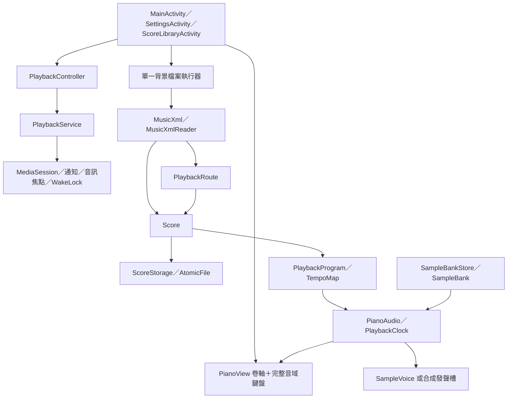

# 系統架構

## 1. 分層總覽

## 2. 模組責任

| 模組 | 元件 | 責任 |
|---|---|---|
| 操作介面 | MainActivity | 播放、進度、速度、聲部、音色、摘要 |
| 設定 | SettingsActivity | 顯示模式、主題色彩、自訂 Hue |
| 音譜庫 | ScoreLibraryActivity、ScoreLibrary | 清單、匯入、播放、刪除、上次選取 |
| 播放生命週期 | PlaybackController、PlaybackService | 共用引擎、背景服務、通知、媒體控制、音訊焦點 |
| 視覺 | PianoView | 橫向鋼琴卷軸、完整音域鍵盤、亮鍵 |
| 外觀 | UiTheme、HueSlider | 色彩角色、系統列、色相 |
| 音訊 | PianoAudio | 命令處理、72 發聲槽、混音、限幅、輸出 |
| 音色 | PianoSound、SampleBankStore | 自動／鋼琴／小提琴／合成選擇、多音色庫快取與載入狀態 |
| 採樣 | PianoSample、SampleBank、SampleVoice | WAV 解碼、局部音域、力度層映射、等功率交叉淡化、Hermite 變調、每音色 release／pedal、高音低通 |
| 殘響 | Reverb | 立體聲殘響與尾巴生命週期 |
| 響度 | TimbreBalance、Limiter | 合成曲線、主音量與 look-ahead 限幅 |
| 樂器偵測 | InstrumentDetector | 依 MusicXML 聲部名稱、`score-instrument` 與 `midi-program` 分配鋼琴／小提琴 |
| 播放路由 | ViolinRouting | 依聲部音色、音高與音長選擇鋼琴、低音鋼琴、Spiccato 或 Arco |
| 離線音色校正 | tools/piano_gain.py、tools/prepare_violin.py、tools/rebalance_piano_gains.py | K 加權逐鍵／力度層增益、Arco／Spic 重建與低音鋼琴 manifest |
| 曲目 | Score | 音符、聲部、音色分配、速度、小節、原始 XML |
| 匯入 | MusicXml、MusicXmlReader | XML／MXL／JSON 包裝、解析、反覆、延音線與樂器偵測 |
| 演奏順序 | PlaybackRoute | 反覆、跳房子、D.C.／D.S.、Coda |
| 播放編譯 | PlaybackProgram | 不可變事件、聲部與 part 索引 |
| 時間 | TempoMap、PlaybackClock | tick／秒換算、倍率與實際音符年齡 |
| 保存 | ScoreStorage | 第 2 版 JSON 與原子寫入 |

## 3. 執行緒

| 執行緒 | 工作 | 主要狀態 |
|---|---|---|
| UI／主執行緒 | 觸控、畫面、對話框、進度跳轉 | 目前曲目、UI 狀態、偏好 |
| 主畫面檔案執行器 | 載入、保存 | 解析中的曲目、保存快照 |
| 音譜庫檔案執行器 | 匯入、清單、讀取、刪除 | 音譜摘要 |
| 採樣載入執行器 | 載入音色包、PCM 解碼 | 載入代次、銀行快取 |
| 音訊優先執行緒 | 排程、發聲槽、混音 | playing、cursor、踏板、靜音 |

UI 以 `LinkedBlockingQueue<Runnable>` 傳遞音訊命令；音訊執行緒在每個輸出區塊開始時接收命令。畫面每 33 ms 讀取播放位置與亮鍵遮罩。

## 4. 播放路徑

1. `MusicXml.read()` 解析 XML／MXL／JSON。
2. `MusicXmlReader` 建立 `Score`，展開反覆與跳轉、合併延音線。
3. `PlaybackProgram` 將音符與踏板編譯成秒制事件。
4. `PianoAudio.load()` 建立 `PlaybackClock`。
5. 播放時音訊執行緒推進時鐘、觸發事件、混音並輸出 AudioTrack。
6. `PianoView` 讀取 `audio.position`、`audio.lit()`、`audio.attackTime()` 繪製卷軸與鍵盤。

## 5. 視覺路徑

- 卷軸時間軸：水平，音符由右往左移動。
- 音高軸：垂直，依樂曲最低至最高音對應。
- 鍵盤：水平，白鍵與黑鍵依完整音域動態建立。
- 兩者共用同一份 `Score` 與播放位置，因此同一個音符會在卷軸與鍵盤同時出現。

## 6. 外部介面

- 檔案選擇：`ACTION_OPEN_DOCUMENT`。
- 音訊：AudioTrack、AudioManager。
- 儲存：APP 私有檔案、SharedPreferences。
- 無伺服器、資料庫服務或網路播放 API。
