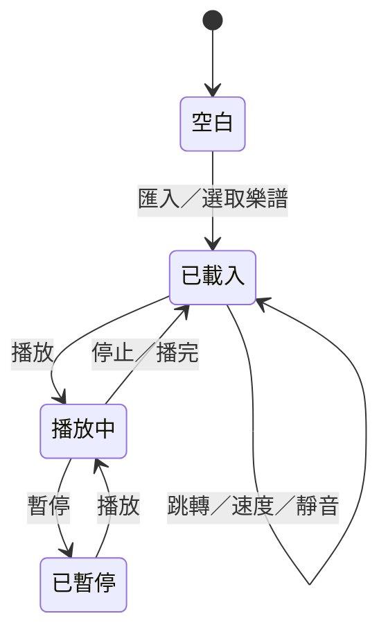

# 系統設計

## 1. 設計目標

- 專注於「播放 MusicXML 鋼琴樂曲」。
- 視覺回饋必須與聲音同步，讓使用者能同時看見卷軸與琴鍵。
- 不引入帳號、網路或錄音權限。
- 保持既有離線解碼、背景播放與主題設定的穩定性。

## 2. 主要狀態

## 3. 設計決策

| 決策 | 理由 | 取捨 |
|---|---|---|
| 移除手動彈奏與錄音 | 產品定位為播放器 | 無法即時試音 |
| 移除匯出 | 只保留匯入與播放 | 無法另存樂譜 |
| 卷軸時間水平、音高垂直 | 符合 DAW／鋼琴卷軸慣例，長音容易辨識 | 與下方水平鍵盤非幾何對齊 |
| 鍵盤完整顯示樂曲音域 | 不裁切音符 | 88 鍵時琴鍵變窄 |
| 以同一份 Score 驅動兩個視覺 | 保證同步 | 卷軸需自行處理音高映射 |
| 保留背景播放服務 | 聆聽體驗 | 需處理音訊焦點與 WakeLock |
| 保留音譜庫 | 方便重複播放 | 增加儲存管理 |

## 4. 卷軸同步

`PianoAudio` 是播放時間的單一來源：

- `position`：目前 tick。
- `lit(pitch)`：目前按住的鍵。
- `attackTime(pitch)`：起音時間，用於閃爍。

`PianoView` 每帧讀取這三個值，因此聲音、卷軸與鍵盤不需要各自計時。

## 5. 音域策略

鍵盤與卷軸都使用 `base..topWhite`：

- 最低音往下找白鍵。
- 最高音往上找白鍵。
- 不假設起點為 C，支援 A0 起始的 88 鍵。
- 黑鍵由相鄰白鍵差值為 2 時插入。

## 6. 錯誤處理

- 匯入錯誤以對話框顯示可操作訊息。
- 音訊錯誤透過 `PianoAudio.error` 回到 UI。
- 儲存使用 AtomicFile，避免部分寫入。
- 匯入限制大小、檔案數與 XML 實體，避免資源耗盡。

## 7. 未來方向

- 卷軸顯示秒數設定與減少動態效果。
- A-B 循環。
- 左右手圖例。
- 低階裝置效能模式。
- 內建範例與首次啟動引導。
